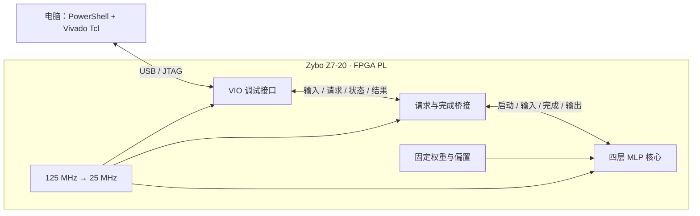

# MLP on FPGA

**在 Zybo Z7-20 的可编程逻辑中，用 Verilog 完成四维特征张量的四层 MLP 推理。**

`Verilog RTL` · `Zynq-7000 / PL` · `INT8 input` · `JTAG / VIO` · `Vivado 2019.1`

从控制台输入四个整数，FPGA 执行乘加、偏置与激活，随后将两个输出值返回电脑。项目把一个小型神经网络的前向传播落到真实硬件上，适合学习状态机、整数运算、时序设计，以及从 RTL 到实板的完整开发流程。

> 当前版本使用固定随机权重，验证的是硬件推理流程，尚未训练成实际分类模型。“四维”指四个输入特征，张量形状为 `[1,4]`，并非四阶张量。已实现 PL 硬件计算卸载，尚未进行 CPU/GPU 对比基准，不宣称已测得加速比。

## 可以做什么

- **真实板上推理**：四层全连接网络 `4 → 8 → 8 → 8 → 2`，前三层 ReLU，末层输出原始有符号值。
- **直接输入张量**：支持 `[1,2,3,4]`、`[[1,2,3,4]]`，也支持逗号或空格分隔的四个整数。
- **观察真实执行阶段**：显示板卡连接、输入写入、推理触发、硬件完成、结果读取和主机耗时。
- **脚本化开发**：构建、下载、交互三个入口，Vivado 工程与所需 IP 由 Tcl 自动生成。
- **阅读一个小而完整的 RTL 实现**：单套乘加数据通路、双缓冲层间存储、状态机调度、请求与完成握手。

计算在 PL 内完成，运行推理不需要 ARM 应用、Python、Linux 系统或 SD 卡。

## 演示

下载本项目位流后，在控制台输入：

```text
输入张量 [1,4]: [1,2,3,4]
...
BOARD_RESULT x=04030201 output=[-59,-139] source=FPGA_PL clock=25MHz
```

这是现有参数下的实板结果。相同输入使用相同位流会产生相同输出。`x` 是打包后的输入：第一个元素放在最低 8 位。

| 输入 `[1,4]` | 输出 `[1,2]` |
| --- | --- |
| `[1,2,3,4]` | `[-59,-139]` |
| `[0,0,0,0]` | `[147,0]` |
| `[-128,-128,-128,-128]` | `[11600,-4051]` |
| `[127,127,127,127]` | `[-2179,-533]` |

## 架构



`mlp_board_top.v` 连接时钟、复位、VIO 和桥接模块；桥接模块实例化推理核心，并将单拍完成信号保持，供较慢的 JTAG 主机读取。

核心以 `IDLE → INIT → MAC → STORE → FINISH` 状态机调度计算。每个神经元先装入偏置，再每拍累加一个乘积，保存结果后继续下一个神经元或下一层。A/B 两组寄存器交替保存层间数据。所有神经元复用同一套乘加数据通路，当前设计没有将整个网络完全并行展开。

## 环境与硬件

以下是已验证的开发环境；其他工具版本和板型尚未验证。

| 项目 | 配置 |
| --- | --- |
| 开发板 | Digilent Zybo Z7-20 |
| FPGA | `xc7z020clg400-1` |
| 主机 | Windows，Windows PowerShell 5.1 |
| 工具 | Vivado 2019.1，安装 Zynq-7000 器件支持及 USB/JTAG 驱动 |
| 工具 IP | Clocking Wizard 6.0、VIO 3.0，由构建脚本生成 |
| 连接 | 板子正常供电，USB 数据线连接板载 JTAG 接口 |
| 时钟 | 板载 125 MHz，核心工作频率 25 MHz |
| 获取源码 | Git；GitHub CLI 不是运行依赖 |

### 首次使用前的本机配置

当前脚本保留开发机的工具路径与板卡匹配配置，克隆到其他机器后需要检查：

1. `scripts/build_board.ps1`、`scripts/program_board.ps1`、`scripts/board_console.ps1` 中的 Vivado 路径，默认是 `D:\vivado\Vivado\2019.1\bin`。
2. `scripts/board_common.tcl` 中的 JTAG 序列号匹配。先在 Vivado Hardware Manager 确认自己的目标板，再替换文件中的原序列号。
3. 硬件服务使用 `127.0.0.1:3121`；下载和控制台脚本会在需要时启动服务。

板卡时钟引脚依据 [Digilent 官方 Zybo Z7 约束文件](https://github.com/Digilent/digilent-xdc/blob/master/Zybo-Z7-Master.xdc)。更换板型需要重新核对器件、引脚和时钟，不能直接使用当前位流。

## 快速开始

下载源码并在 PowerShell 中进入仓库根目录。保持板子供电并连接 USB JTAG。以下命令**逐条运行，确认前一步成功后再继续**。

### 1. 构建电路

```powershell
powershell -NoProfile -ExecutionPolicy Bypass -File .\scripts\build_board.ps1
```

执行综合、布局布线、时序与 DRC 检查，生成：

- `build/board/mlp_board.bit`：用于配置 FPGA 的位流。
- `build/board/mlp_board.ltx`：与位流匹配的调试探针信息。
- `build/board/project/mlp_board.xpr`：可用 Vivado 打开的工程。
- `build/board/timing.rpt`、`utilization.rpt`、`drc.rpt`：构建报告。

成功标志为 `BOARD_BUILD_PASS`。生成文件不纳入 Git，因此首次从源码使用需要构建。重建前关闭已打开的同名 Vivado 工程；构建失败后不要下载残留的旧位流。

### 2. 下载到 FPGA

```powershell
powershell -NoProfile -ExecutionPolicy Bypass -File .\scripts\program_board.ps1
```

通过 JTAG 配置 PL，并检查设计标识、时钟锁定和空闲状态。看到 `PROGRAM_READY` 后进入下一步。此步骤只配置易失逻辑，不写 Flash；断电后需要重新下载。

### 3. 输入张量

```powershell
powershell -NoProfile -ExecutionPolicy Bypass -File .\scripts\board_console.ps1
```

输入四个 `[-128,127]` 范围内的整数，例如 `[1,2,3,4]`。获得输出后可继续输入，输入 `q` 退出。也可发起单次请求：

```powershell
powershell -NoProfile -ExecutionPolicy Bypass -File .\scripts\board_console.ps1 -Tensor '[1,2,3,4]'
```

| 场景 | 需要执行 |
| --- | --- |
| 首次使用，或修改 RTL、参数、硬件配置 | 构建 → 下载 → 控制台 |
| 板子断电重启，源码未改且生成文件仍在 | 下载 → 控制台 |
| 板上配置仍有效，只关闭了控制台 | 控制台 |
| 只更换输入张量 | 在控制台继续输入 |

## 数值格式

| 数据 | 格式与范围 |
| --- | --- |
| 输入 | 4 个有符号 8 位整数，`[-128,127]` |
| 权重 | 有符号 8 位整数，当前参数范围 `[-3,3]` |
| 偏置 | 有符号 16 位整数，当前参数范围 `[-8,8]` |
| 层间激活与输出 | 有符号 32 位整数 |
| 乘积与累加器 | 有符号 40 位整数 |

当前采用纯整数运算，小数位为 0，无缩放、舍入或饱和。四层共 176 个权重、26 个偏置，固定在 `rtl/mlp4_weights.vh`。在当前参数范围下，各层输出的绝对值保守上界为 1,544、37,064、889,544、21,349,064，均可用有符号 32 位表示。

修改权重后需要重新构建和下载；扩大数值范围或网络规模时，需要重新分析溢出与位宽。当前没有运行时权重加载、浮点计算、自动模型转换或训练功能。

## 验证与性能边界

已有 **93 组真实 PL 数值检查通过**，包含典型输入、边界与随机向量，记录见 [实板验证记录](docs/board_validation.txt)。这些是本版本的历史验证证据；精简后的仓库不包含原批量测试脚本，也没有配置自动化 CI 验证。

| 指标 | 当前记录 |
| --- | --- |
| 核心时钟 | 25 MHz |
| 核心延迟 | 按 RTL 周期推导：229 拍，约 9.16 μs |
| 桥接完成状态 | 核心完成后再经过一拍保持 |
| 整体资源，包含调试逻辑 | 1,716 LUT / 2,558 FF / 0 DSP / 0 BRAM / 1 MMCM |
| 建立 / 保持时序裕量 | WNS 26.059 ns / WHS 0.030 ns |
| DRC | 0 Error；保留调试 hub 无负载与未实例化 PS7 的 Warning |

小整数乘法被映射为 LUT 逻辑，因此 DSP 使用量为 0；乘加仍由 PL 电路执行。

**核心周期延迟不等于控制台端到端延迟。** 每次请求都会启动 Vivado 硬件工具并建立 JTAG 连接，主机等待通常为秒级。当前接口适合教学和调试，不用于评估高吞吐加速效果。若要比较 CPU 与 FPGA，应分别测量核心计算、传输和完整应用耗时。

## 日志与常见问题

控制台只显示关键阶段、耗时及警告错误，完整工具输出写入 `build/board/last_request_console.log` 和 `last_request.log`，每次请求覆盖。显示的是主机观察到的阶段，不是逐层或逐拍硬件跟踪。

| 现象 | 检查方法 |
| --- | --- |
| 找不到板卡 | 检查供电、USB 数据线、JTAG 驱动和脚本中的序列号 |
| 缺少位流或探针文件 | 先完成构建，再下载相匹配的 `.bit` / `.ltx` |
| 找不到 VIO 或设计标识不符 | 重新下载本项目位流，确认板子未被其他工程覆盖 |
| 提示已有控制台占用 | 先退出另一个板上推理控制台 |
| 已输出结果，但提示符尚未返回 | 工具仍在释放 JTAG 和退出，查看实时阶段日志 |
| 改了源码却还是旧结果 | 显式重新构建并下载；控制台不会自动构建或检查文件哈希 |

## 源码导航

```text
rtl/
  mlp4.v                 四层前向推理、状态机与乘加数据通路
  mlp4_weights.vh        固定权重与偏置
  mlp_jtag_bridge.v      启动握手、完成保持、完成计数
  mlp_board_top.v        板级时钟、复位与模块连接
constraints/
  zybo_z7_clock.xdc      时钟引脚与电气约束
scripts/
  board_console.ps1     交互输入与实时日志
  board_infer.tcl       单次推理入口
  board_common.tcl      JTAG / VIO 访问与请求流程
  build_board.ps1/.tcl  构建电路
  program_board.ps1/.tcl 下载与初始化
docs/
  step3_board.md         板上使用与原理补充
  board_validation.txt 实板验证记录
```

建议从 `mlp4.v` 阅读前向计算，再看 `mlp_jtag_bridge.v` 的握手，最后通过 `mlp_board_top.v` 理解完整连接。电脑侧脚本负责操作流程，Verilog 描述的电路经 Vivado 构建后进入 FPGA。

## 交流与贡献

欢迎提出问题或改进建议。报告问题时请附上板型、Vivado 版本、复现步骤和相关日志；硬件改动应说明数值一致性、时序及资源变化。可探索的方向包括训练权重导入、量化设计、部分并行计算和更低开销的数据接口，这些尚未在当前版本实现。
